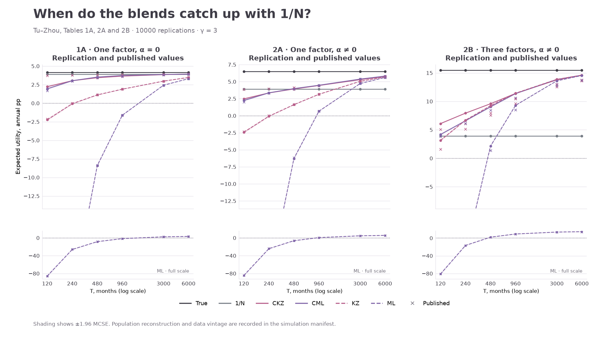
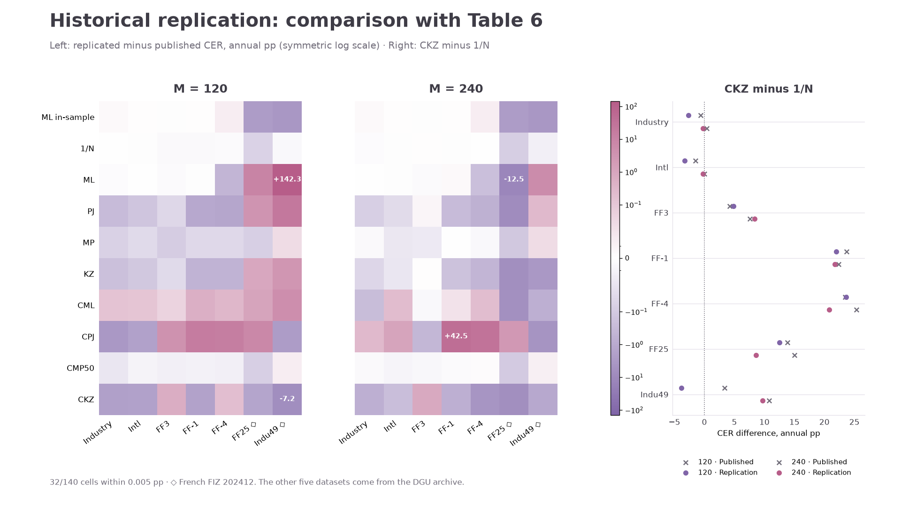
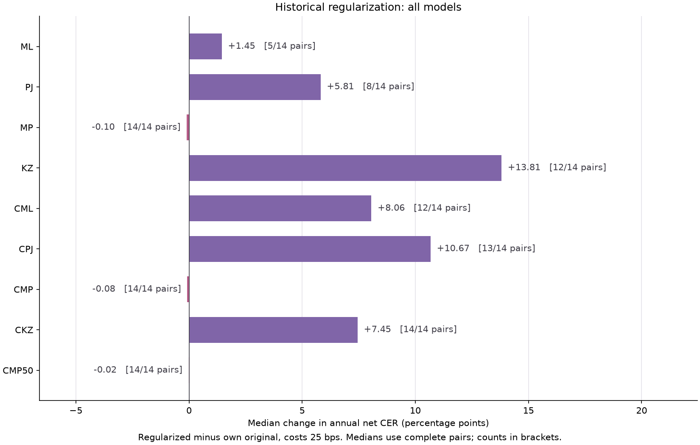
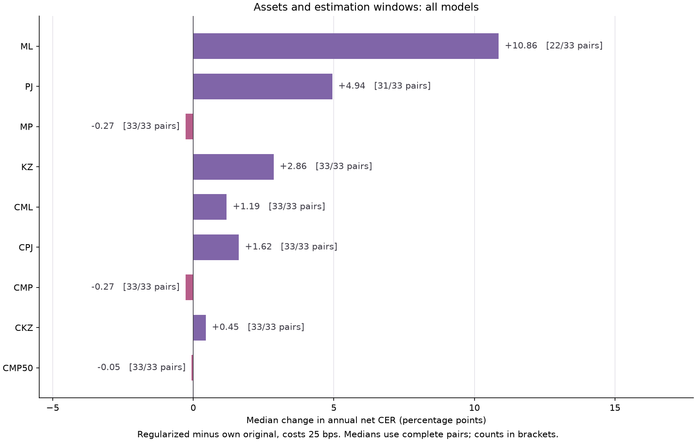
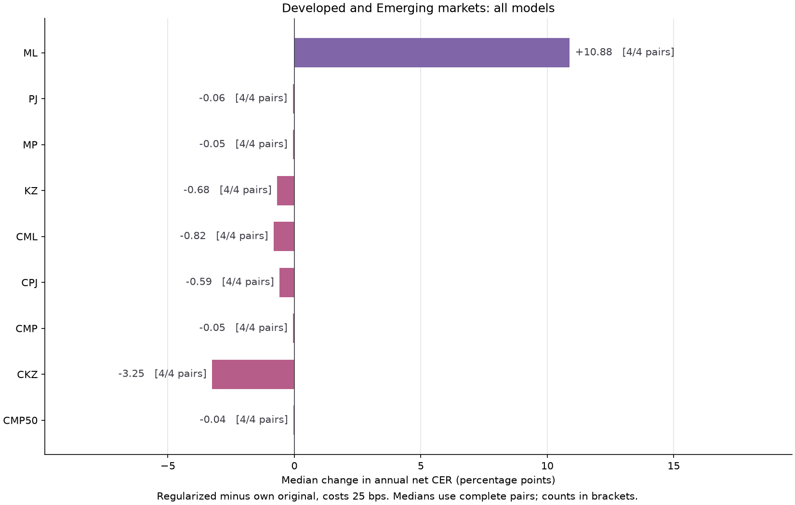

# Markowitz Meets Talmud: replication and exploratory extensions

Numerical replication of Jun Tu and Guofu Zhou (2011), *Markowitz Meets Talmud: A Combination of Sophisticated and Naive Diversification Strategies*, Journal of Financial Economics 99, 204–215. [Article DOI](https://doi.org/10.1016/j.jfineco.2010.08.013).

The study combines estimated portfolio rules with equal weighting to reduce the effect of parameter estimation error. This repository implements the main-paper simulations, historical rolling-window evaluation and three retained exploratory studies. NumPy and explicit CUDA backends use float64. CUDA requests fail explicitly when unavailable.

**Status: partial numerical replication.** Several controls reproduce the article, but substantial discrepancies remain. Tests establish software properties; they do not establish exact reproduction of published results. The extensions compare against our implemented rules.

## Main-paper results

The completed simulation uses 10,000 replications for each of three return-generating scenarios and six sample sizes: 120, 240, 480, 960, 3000 and 6000 months. Published and computed values are included for Tables 1–5.

| Simulation audit classification | Cells |
| --- | ---: |
| Match at the rounding tolerance | 118 |
| Compatible with the stated Monte Carlo uncertainty criterion | 105 |
| Unresolved numerical discrepancy | 329 |
| Total | 552 |

These are audit categories, including deterministic benchmark cells. Monte Carlo compatibility is not proof of correct identification of the authors' specification. In the three-factor simulation, the true-parameter utility is **15.46** in our reconstruction versus **14.60** in the article; this population-calibration difference cannot be removed by adding replications.

The historical exercise covers seven datasets and windows of 120 and 240 months. **32 of 140** Table 6 cells match within 0.005 annual percentage points. The following complete set of out-of-sample rules illustrates both close controls and material differences on Industry11, M=120:

| Rule | Article CER | Replicated CER |
| --- | ---: | ---: |
| 1/N | 3.66 | 3.66 |
| ML | -38.18 | -38.18 |
| PJ | -9.21 | -9.48 |
| MP | -0.76 | -0.82 |
| KZ | -3.59 | -3.78 |
| CML | -1.39 | -1.26 |
| CPJ | 3.15 | -0.25 |
| CMP50 | 2.21 | 2.19 |
| CKZ | 3.02 | 1.02 |

CER is the annualized mean–variance score in percentage points, not a compounded investment return. The Table 6 CMP label is mapped to a fixed 50/50 MP–EW mixture, consistent with the empirical discussion; jackknife CMP is kept distinct in the extensions.

Full results: [Tables 1–5 comparison](results/article/simulation/tables1_5_comparison.csv), [Table 6 comparison](results/article/empirical/table6.csv), [empirical checks](results/article/empirical/empirical_checks.csv).





## Three retained exploratory studies

All studies evaluate 10 original rules, including EW and separate CMP/CMP50, and nine covariance-regularized counterparts. Each counterpart is compared with its own original and separately with EW. Equal weighting has no covariance estimate to regularize.

1. **Historical regularization:** the original seven datasets, both estimation windows and original out-of-sample calendars, 14 cases.
2. **Asset dimension and estimation window:** 10/25/49 industries, 60/120/240-month windows, five predetermined nested subsets for the smaller universes and one full universe, 33 cases. Every case uses January 2012–December 2024 out of sample.
3. **Developed and Emerging markets:** six USD size/value portfolios per market, windows of 120/240 months, the same 2012–2024 out-of-sample dates, four cases.

The table reports the **median change in annual net CER** after regularization, with **complete/expected matched pairs** in parentheses. Costs are 25 bps per unit of risky turnover. Every model is included, including unfavorable results.

| Model | Historical regularization | Assets × window | Developed / Emerging |
| --- | ---: | ---: | ---: |
| ML | +1.45 (5/14) | +10.86 (22/33) | +10.88 (4/4) |
| PJ | +5.81 (8/14) | +4.94 (31/33) | -0.06 (4/4) |
| MP | -0.10 (14/14) | -0.27 (33/33) | -0.05 (4/4) |
| KZ | +13.81 (12/14) | +2.86 (33/33) | -0.68 (4/4) |
| CML | +8.06 (12/14) | +1.19 (33/33) | -0.82 (4/4) |
| CPJ | +10.67 (13/14) | +1.62 (33/33) | -0.59 (4/4) |
| CMP | -0.08 (14/14) | -0.27 (33/33) | -0.05 (4/4) |
| CKZ | +7.45 (14/14) | +0.45 (33/33) | -3.25 (4/4) |
| CMP50 | -0.02 (14/14) | -0.05 (33/33) | -0.04 (4/4) |

Medians use completed matched pairs only. Coverage differs across models, so these columns are not a ranking by final portfolio performance. A failed original is not counted as a numerical win for a surviving counterpart.

The original CKZ result remains visible in the all-model historical study: **+7.45 pp**, with 11 wins among 14 pairs at 25 bps. At zero costs its median change was about **−0.35 pp**, so the earlier success was cost dependent.

On the dimension/window grid, regularized KZ improves its original in **32/33** cases, but beats EW in only **6/33**. Corresponding counts are 31/33 and 11/33 for CML, 30/33 and 13/33 for CPJ, and 28/33 and 12/33 for CKZ. Shorter windows show larger matched gains for these families at N=25. This does not establish a monotonic benefit from adding assets.

On international portfolios, ML improves its original in 4/4 cases, but none of the four corresponding conditional 95% intervals excludes zero. KZ, CML, CPJ and CKZ have negative matched effects in all four cases. For example, regularized CKZ loses to its original in 4/4, yet still beats EW in 4/4: the two comparisons answer different questions.

Full all-model summary: [27 model/study rows](results/summary.csv). Per-case results, scores and original execution manifests are in [results/extensions](results/extensions).







## Interpretation and limitations

- Original simulation loadings, residual-variance seeds and some data vintages are not fully identified. The factor model is a documented reconstruction.
- CPJ uses an approximation to quadratic moments. Historical CKZ/CPJ discrepancies remain even where EW and ML controls match.
- Extensions preserve each original component signal and mixture coefficient while modifying its risk matrix. These are hybrid estimators; the original article's optimality guarantees do not automatically carry over.
- Large long–short positions, path failures and unmodeled financing/short-borrow fees limit economic interpretation. Trading costs alone are not complete implementation costs.
- Subsets overlap, comparisons are dependent and intervals are not adjusted for multiple testing. The retained studies were chosen after earlier exploration and are exploratory.
- Archived unsuccessful trials are excluded from the public implementation, not treated as evidence that only positive trials were run. No prospective or universal superiority claim is made.

## Reproduce

Python 3.12 or newer. Create and activate a virtual environment, then install:

```sh
python -m pip install -r requirements-ml.lock
python -m pip install -e . --no-deps
python -m pytest -q
```

`requirements-ml.lock` includes the base dependencies and scikit-learn needed for covariance regularization. CUDA is optional; install `requirements-gpu.lock` in the same environment to use an NVIDIA GPU. The recorded full run used an RTX 3070 and float64. No speedup is promised for every matrix size.

```sh
# Main-paper checks, data preparation, full simulations, historical evaluation and figures
python -m replication.pipeline --stage all --device cuda --out runs/article_new

# The three retained studies, using the completed historical baseline
python -m replication.all_model_studies --experiment all --device cuda --download --baseline runs/article_new/replication --out runs/studies_new
```

Use `--device cpu` for a CPU run. These commands launch the full research calculation and may take substantial time. Use fresh output directories after code/specification changes. For a small main-paper wiring check use `--stage smoke`; its output is not a full replication. The optional `--retained` study argument verifies an older CKZ run when available; a fresh clone does not require that intermediate artifact.

The committed CSVs and figures can be inspected without downloading data or rerunning research:

```sh
python scripts/verify_results.py
python scripts/build_figures.py
```

[Reproducibility and artifact layout](docs/reproducibility.md) · [Statistical conventions and sources](docs/methodology.md).

## Repository layout

| Path | Contents |
| --- | --- |
| `src/replication` | Portfolio estimators, data preparation, CPU/CUDA backend, simulations and retained studies |
| `tests` | Numerical, timing, source-integrity and synthetic integration checks |
| `configs` | Historical dataset definitions |
| `references` | Transcribed published table values |
| `results/article` | Completed main-paper comparison tables and execution manifests |
| `results/extensions` | Completed per-case summaries, scores and manifests for the three studies |
| `results/figures` | Rebuildable main-paper and all-model extension figures |
| `scripts` | Compact-result export, verification and figure generation |

Downloaded source archives, prepared panels, full path/weight files, Monte Carlo chunks, IDE settings, local setup helpers, presentation drafts and personal rehearsal materials are excluded from Git.
